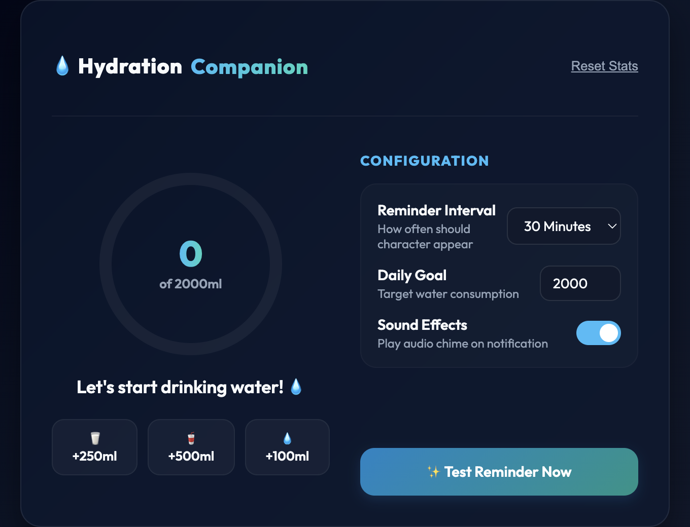
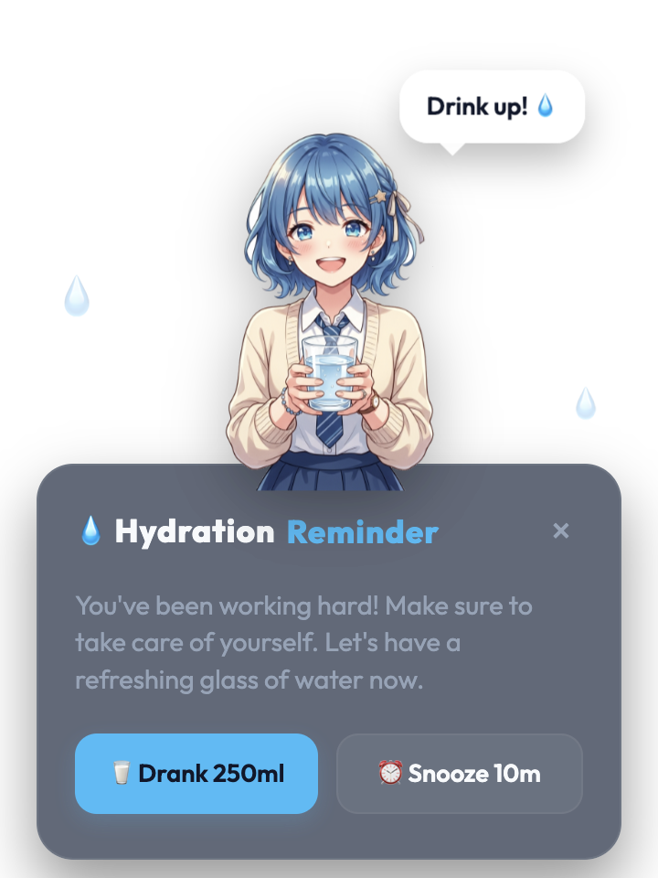

# 💧 Anime Hydration Reminder

A desktop hydration reminder built with Electron. A friendly anime character pops up on a schedule to nudge you to drink water, while a menu bar tray icon tracks your daily progress.

## Features

- **Menu bar tracker** — live `💧 consumed/goal ml` progress shown right in the tray
- **Animated reminder popup** — a floating, transparent overlay with an anime character, a randomized speech bubble, and an encouraging message
- **Configurable reminders** — choose how often you're reminded (15 min – 2 hours)
- **Daily goal tracking** — set a custom daily water target (500–5000 ml)
- **Quick-add logging** — log water from the dashboard (+100/250/500 ml) or directly from the popup ("Drank 250ml")
- **Snooze** — push a reminder back by 10 minutes instead of dismissing it
- **Sound chime** — a synthesized water-drop chime plays on each reminder (can be muted)
- **Persistent state** — your progress, goal, and settings are saved locally and automatically reset each new day
- **Auto-generated tray icon** — a transparent icon is generated on first run, no assets required

## Requirements

- [Node.js](https://nodejs.org/) and npm

## Getting Started

```bash
npm install
npm start
```

The dashboard window opens automatically on launch. Closing it leaves the app running in the tray (macOS); click the tray icon any time to reopen it.

## Screenshots

| Dashboard | Reminder Popup |
| --- | --- |
|  |  |

## Usage

- **Tray icon** — shows live progress and provides quick actions: open settings, test the reminder animation, reset today's count, mute sound, or quit
- **Dashboard** — set your reminder interval, daily goal, and sound preference; log water manually with the quick-add buttons
- **Reminder popup** — appears automatically on your chosen interval; drink, snooze, or dismiss it

## Project Structure

```
main.js               # Electron main process — tray, windows, timers, state persistence
dashboard/            # Settings & progress dashboard window
  index.html
  dashboard.js
popup/                # Animated reminder overlay window
  index.html
  popup.js
assets/               # Shared styles, character art, tray icon
```

## How It Works

- App state (water consumed, goal, reminder interval, mute setting) is persisted to a JSON file in the OS user-data directory and reloaded on launch, with the consumed count automatically resetting each new day.
- A timer in the main process schedules the next reminder popup based on the configured interval, re-scheduling itself after each fire (or after a snooze).
- The popup window processes a raw character image on the fly in the renderer, using a canvas flood-fill to strip the white background and produce a transparent PNG.

## License

MIT
